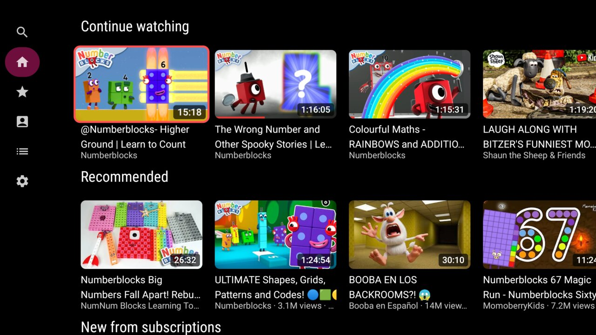
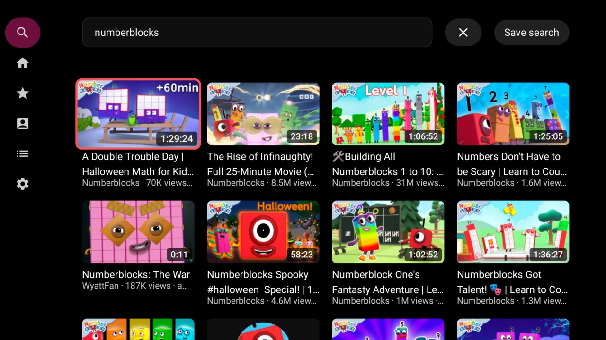

# TubePipe

YouTube for Android TV, without ads or an account.



TubePipe is free software under the GPL-3.0 (see `LICENSE`). It builds on
[NewPipe](https://github.com/TeamNewPipe/NewPipe) and
[PipePipe](https://github.com/InfinityLoop1308/PipePipe), whose extractor does all the
service access. Thanks to both teams.

## Status

Early release: Home, Trending, Subscriptions, Library, Search and the player work with the TV remote alone. The stack
and module layout are recorded in `docs/decisions/architecture.md`.



## Download

The latest build is [TubePipe 0.2.2](https://github.com/shourovrm/tubepipe/releases/tag/v0.2.2).
Download `tubepipe-0.2.2.apk` from that page and install it on the TV with `adb install tubepipe-0.2.2.apk`, or
open it with a file manager on the TV that can install apps. All releases are on the
[releases page](https://github.com/shourovrm/tubepipe/releases).

## Install

Building from source needs JDK 21 and the Android SDK (compileSdk 37).

```sh
git clone --recurse-submodules <repo-url>
# or, in an existing clone:
git submodule update --init extractor
./gradlew :app:assembleRelease
```

The APK is `app/build/outputs/apk/release/app-release.apk`.

## Run

Connect an Android TV device (`adb connect <tv-ip>`), then:

```sh
./gradlew :app:installRelease
```

TubePipe appears in the TV launcher's app list.

## Test

```sh
./gradlew ktlintCheck lint test
```
